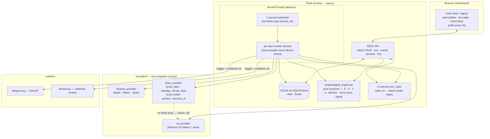
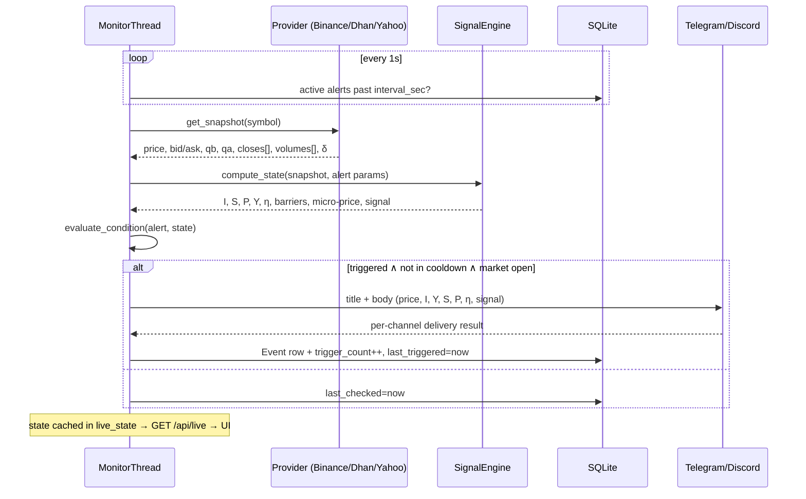

# From MT5 Expert Advisor to a Multi-Market Python Alert Engine

*Porting the volume-imbalance / uncertainty-zones model of Pulido, Rosenbaum &
Sfendourakis (2026) from MQL5 to a Flask alert app covering US equities,
crypto, and Indian stocks.*

---

## 1. Why this exists

A January 2026 paper in *Finance & Stochastics* — **"Understanding the
worst-kept secret of high-frequency trading"** (Pulido, Rosenbaum &
Sfendourakis, 30:329–396) — finally derived, from an optimal market-making
problem, why the limit-order-book **volume imbalance**

```
I = (qb − qa) / (qb + qa)   ∈ [−1, 1]
```

predicts the direction of the next mid-price move. The original companion
implementation was an MT5 Expert Advisor (`VolImbalance_UncertaintyZones_EA.mq5`)
that traded the signal on forex/metals.

This project takes the same model and turns it into something different: not a
trading robot, but a **multi-market alert engine**. Instead of placing orders,
it watches symbols across three venues and pushes a Telegram/Discord message
the moment the model's conditions line up.

The port is deliberately faithful. Every quantity in the EA has a 1:1 Python
counterpart:

| Paper / EA concept | MQL5 (EA) | Python (this repo) |
|---|---|---|
| Imbalance `I` | `CalculateImbalance()` over a tick ring-buffer | `signal_engine.imbalance_from_depth` (real L2) / `imbalance_from_bars` (proxy) |
| Efficient price `S` | fast EMA via `iMA` handle | `signal_engine.ema(closes, n)` |
| Grid mid `P` | `delta * MathRound(rawMid/delta)` | `delta * round(raw_mid/delta)` |
| State `Y = S − P` | `UpdateUncertaintyZoneState()` | `compute_state()` |
| Barriers `P ± δ(½+η)` | same function | `compute_state()` |
| `η̂ = Nc/(2·Na)` | `EstimateEtaFromHistory()` | `estimate_eta(closes)` |
| Micro-price (Stoikov 2018) | `GetMicroPrice()` | `compute_state()` |
| Signal rule | `GenerateSignal()` | `compute_state()` → `signal` |
| SL/TP + order execution | `ExecuteSignal()` | **replaced by notifications** (`notifiers/`) |

One place where the Python version is *stronger* than the EA: MT5 retail feeds
have no Level-2 data, so the EA had to approximate `qb`/`qa` from up/down tick
volume. Binance and Dhan both expose real order-book depth, so for crypto and
NSE stocks this app computes the **true** paper imbalance; only the US path
(Yahoo Finance) still uses the EA's bar-volume approximation.

---

## 2. System architecture

### 2.1 Component view



### 2.2 Life of one alert check



### 2.3 Data flow of the signal itself

```
   Binance /depth ──► qb, qa ──────────────┐
   Dhan quote_data depth ──► qb, qa ───────┤        I = (qb−qa)/(qb+qa)
   Yahoo 1m bars ──► up-vol / down-vol ────┘  (fallback: bar-volume proxy)

   1m closes ──► EMA(n) ──► S ─┐
   bid/ask ──► mid ──► snap    ├──► Y = S − P ──► barriers P ± δ(½+η)
              to δ-grid ──► P ─┘

   closes ──► continuations/alternations ──► η̂ = Nc/(2·Na)

   ┌───────────────────────────────────────────────────────────┐
   │  LONG  : I >  thr  ∧  Y >  y_thr  (∧ near upper barrier)  │
   │  SHORT : I < −thr  ∧  Y < −y_thr  (∧ near lower barrier)  │
   └───────────────────────────────────────────────────────────┘
```

---

## 3. Codebase walkthrough

```
quant_alert_2/
├── app.py                  ← Flask wiring + REST API (≈180 lines)
├── config.py               ← .env → constants; placeholder detection
├── engine/
│   ├── signal_engine.py    ← THE MODEL. Pure functions, no I/O.
│   ├── monitor.py          ← scheduler, evaluation, dispatch, cooldowns
│   └── models.py           ← Alert + Event ORM models
├── providers/               ← one contract: get_snapshot(symbol) → dict
│   ├── binance_provider.py
│   ├── dhan_provider.py
│   └── us_provider.py
├── notifiers/
│   ├── telegram.py
│   └── discord.py
├── templates/index.html    ← single-page dashboard
└── static/app.js, style.css
```

### 3.1 `engine/signal_engine.py` — the model, kept pure

All the paper math lives in one dependency-free module so it can be unit-tested
without any network. The heart is `compute_state(snapshot, params)`:

```python
I = imbalance_from_depth(bid_qty, ask_qty)      # real L2 if available
if I is None:
    I = imbalance_from_bars(closes, volumes)    # EA-style retail proxy

S = ema(closes, ema_period)                     # efficient-price proxy
P = delta * round(raw_mid / delta)              # snap mid to tick grid
Y = S - P                                       # the paper's state variable

eta = params.eta or estimate_eta(closes)        # η̂ = Nc / (2·Na)
zone_width = delta * (0.5 + eta)                # uncertainty-zone half-width

signal = "LONG"  if I >  thr and Y >  y_thr else \
         "SHORT" if I < -thr and Y < -y_thr else None
```

`estimate_eta` walks the close series counting *continuations* (a move in the
same direction as the previous move) vs *alternations*, exactly like the EA's
`EstimateEtaFromHistory()`, clamped to `(0.01, 0.49)`.

The Stoikov micro-price `((I+1)/2)·ask + ((1−I)/2)·bid` is computed alongside
and shown in the UI/notifications as a sanity reference.

### 3.2 `providers/` — one snapshot contract, three markets

Every provider returns the same dict, which is what makes the engine
market-agnostic:

```python
{
  "price": float, "bid": float|None, "ask": float|None,
  "bid_qty": float|None, "ask_qty": float|None,   # L2 depth (None → bar proxy)
  "closes": [...], "volumes": [...],              # last ~120 one-minute bars
  "tick_size": float,                             # δ for the grid & barriers
  "prev_close": float|None, "source": str,
}
```

- **Binance** (`binance_provider.py`) — three public endpoints per check:
  `/api/v3/depth?limit=5` (aggregated top-5 → `qb`, `qa`), `/api/v3/klines`
  (1m closes for `S` and `η̂`), `/api/v3/ticker/24hr`. The tick size `δ` comes
  from `exchangeInfo`'s `PRICE_FILTER`, cached 24h. No key required; if
  `BINANCE_API_KEY` is set it's attached as `X-MBX-APIKEY`.

- **Dhan** (`dhan_provider.py`) — uses the dhanhq **v2** SDK
  (`DhanContext` + `dhanhq`). Dhan addresses instruments by numeric
  `security_id`, so the provider downloads the public **scrip master CSV**
  once, filters it to NSE equities, caches it locally, and resolves
  `RELIANCE → security_id` at request time. `quote_data()` supplies the
  5-level depth (true imbalance) and `intraday_minute_data()` the 1-minute
  closes. **Every failure path** — missing keys, unknown symbol, API error —
  degrades to Yahoo Finance with the `.NS` suffix, so Indian alerts work out
  of the box even before Dhan credentials are added.

- **US / Yahoo** (`us_provider.py`) — `yfinance` 1-minute history (2 days) for
  closes/volumes plus `fast_info`/`info` for last price and (when present)
  top-of-book bid/ask sizes. A 15-second in-process cache keeps polling
  friendly to Yahoo's rate limits.

`providers/__init__.py` also owns `is_market_open()`: crypto is 24/7, NSE
9:15–15:30 IST, US 9:30–16:00 ET (checked against both EST and EDT offsets).

### 3.3 `engine/monitor.py` — scheduling and dispatch

A single daemon `MonitorThread` ticks once per second, queries for active
alerts whose `interval_sec` has elapsed, and hands each one to a short-lived
worker thread with an in-flight guard — so a hung Yahoo request on one alert
never delays a 10-second crypto alert.

Trigger gating is three conditions ANDed together:

1. `evaluate_condition()` — the alert's rule matched (price cross, %-change,
   or model signal),
2. **cooldown** — `now − last_triggered ≥ cooldown_sec` (default 5 min), so a
   persistent signal doesn't spam every poll,
3. **market hours** — imbalance alerts are suppressed while the venue is
   closed (stale books produce meaningless imbalance).

On a trigger the monitor renders a rich message (price, micro-price, `I`, `Y`,
`S`, `P`, `η`, barriers, signal), fans it out via `notifiers.send()`, and
persists an `Event` row including the full model state and the per-channel
delivery result — the UI's event feed and the audit trail are the same data.

### 3.4 `notifiers/` — Telegram & Discord

Both are ~30 lines of `requests`: Telegram via the Bot API `sendMessage`
(HTML parse mode), Discord via a webhook embed. Both return
`{"ok": bool, "error": ...}` instead of raising, so one dead channel never
blocks the other, and the delivery result lands in the `Event` row for
debugging.

### 3.5 `app.py` + UI — thin API, live dashboard

The Flask layer is deliberately thin: CRUD on alerts, `GET /api/live` (the
monitor's in-memory state), `GET /api/events`, `GET /api/preview` (one-shot
model state for any symbol — the UI's **Preview signal** button, great for
sanity-checking a symbol before saving an alert), and
`POST /api/test_notification`.

The dashboard is a single dark-theme page (no build step): an alert builder
with a collapsible *model parameters* section, a live table showing
`price / I / Y(ticks) / η / signal` per alert refreshed every 4 seconds, a
status bar with integration and market-hours badges, and the trigger feed.

### 3.6 Persistence — `engine/models.py`

Two tables. `Alert` stores the definition *and* its model parameters
(`imbalance_threshold`, `y_threshold_ticks`, `eta` — `NULL` means
auto-estimate, `ema_period`, `require_barrier`) plus operational fields
(`interval_sec`, `cooldown_sec`, `trigger_count`, `last_error`). `Event` is
the immutable trigger log with the frozen model state as JSON.

---

## 4. Design decisions worth calling out

**Real depth where possible, EA proxy where not.** The paper's `I` is an
order-book quantity. Binance and Dhan give us the book, so we use it; Yahoo
doesn't, so the US path reuses the MT5 EA's up/down-bar volume approximation.
The UI labels every reading with its `imbalance_source` (`orderbook` / `bars`)
so you always know which estimator you're looking at.

**Alerts, not orders.** The EA's `ExecuteSignal()` / `ManageOpenPositions()`
became `notifiers.send()` + cooldown. This sidesteps the entire optimization
problem the original article's Section 7 documents (the raw signal is not
profitable after costs without tuning) while keeping what the signal is
genuinely good at: telling a human *"the book is leaning, look now."*

**Pure signal engine.** All math is side-effect-free and unit-testable;
providers do I/O; the monitor does state. Adding a fourth market (e.g. MCX
commodities or another crypto exchange) means writing one file that returns
the snapshot dict — nothing else changes.

**Graceful degradation everywhere.** No Dhan keys → Yahoo `.NS`. No Binance
keys → public endpoints. A dead notifier → logged in the event's delivery
JSON. A provider exception → stored on the alert (`last_error`, red pill in
the UI) without stopping the scheduler.

---

## 5. Running it

```bash
pip install -r requirements.txt
cp .env.example .env    # add keys: Dhan, Telegram, Discord (Binance optional)
python3 app.py          # http://localhost:5000
```

Try it in 60 seconds: open the dashboard → market *Crypto*, symbol `BTCUSDT`,
type *Imbalance signal* → **Preview signal** (you'll see live `I`, `Y`, `η`
straight from the Binance book) → **Test notifications** → **Create alert**.

---

## 6. References

1. Pulido, S., Rosenbaum, M., & Sfendourakis, E. (2026). *Understanding the
   worst-kept secret of high-frequency trading.* Finance and Stochastics,
   30, 329–396.
2. Robert, C.-Y., & Rosenbaum, M. (2011). *A new approach for the dynamics of
   ultra-high-frequency data: the model with uncertainty zones.* Journal of
   Financial Econometrics, 9, 344–366.
3. Stoikov, S. (2018). *The micro-price: a high-frequency estimator of future
   prices.* Quantitative Finance, 18, 1959–1966.
4. Huang, W., Lehalle, C.-A., & Rosenbaum, M. (2015). *Simulating and
   analyzing order book data: the queue-reactive model.* JASA, 110, 107–122.

> ⚠️ This app sends alerts; it does not trade. The model is a research signal,
> not financial advice.
