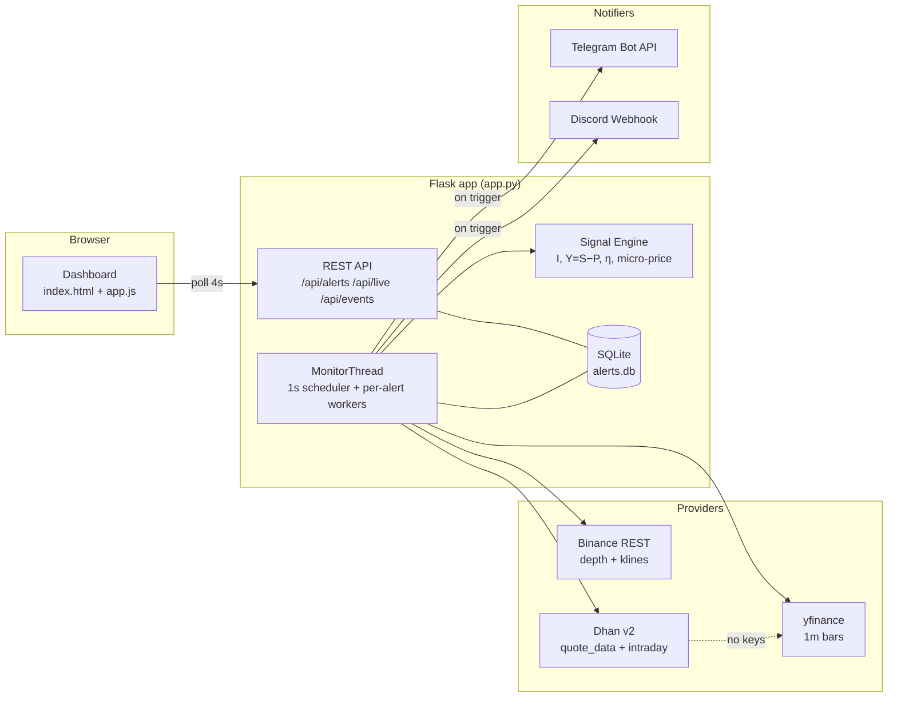

# ⚡ Quant Alert

Multi-market **alert engine + Flask dashboard** built on the volume-imbalance /
uncertainty-zones model from *Pulido, Rosenbaum & Sfendourakis (2026),
"Understanding the worst-kept secret of high-frequency trading", Finance &
Stochastics 30:329–396* — the model behind the original MT5 Expert Advisor,
re-implemented in Python for three markets:

| Market | Data source | Order-book imbalance |
|---|---|---|
| 🪙 Crypto | **Binance** public REST (keys optional) | ✅ true L2 depth (top 5 levels) |
| 🇮🇳 India (NSE) | **Dhan** API v2 (`dhanhq`) — falls back to Yahoo `.NS` without keys | ✅ 5-level depth via `quote_data` |
| 🇺🇸 US stocks | **Yahoo Finance** (`yfinance`, no key) | ~ up/down-bar volume proxy |

Alerts are delivered to **Telegram** and **Discord**; all secrets live in `.env`.

**Zero-setup scanning:** a built-in market scanner runs from the moment the app
starts — no alerts need to be created. Per market it watches the **top-50
high-volume names plus the headline indexes** and notifies on model signals:

| Market | Auto watchlist |
|---|---|
| 🪙 Crypto | top 50 USDT pairs by 24h quote volume (refreshed hourly, live from Binance) |
| 🇮🇳 India | all NIFTY 50 constituents + **NIFTY 50** and **Bank NIFTY** indexes |
| 🇺🇸 US | 50 most-traded large caps + **S&P 500, Dow, NASDAQ**, SPY, QQQ |

Scans are batched (2 HTTP calls for all 50 crypto pairs; 1 Dhan `quote_data`
call for all NIFTY names; 1 Yahoo download for all US symbols), signals are
confirmed with a full depth+klines check before notifying, and a per-symbol
cooldown (default 15 min) prevents spam. Indexes additionally notify on day
moves beyond ±1%. Results appear in the dashboard's **Market Scanner** panel
with a **＋ alert** shortcut to promote any row into a custom alert. Tune via
`SCANNER_*` keys in `.env` (`SCANNER_ENABLED=false` turns it off,
`SCANNER_IMBALANCE_THRESHOLD` default 0.4, `SCANNER_NOTIFY=false` for
watch-only mode). Scanner state is served at `GET /api/scanner`.

---

## Quick start

```bash
cd quant_alert_2
pip install -r requirements.txt

cp .env.example .env        # then edit .env with your keys
python3 app.py              # → http://localhost:5000
```

### `.env` keys

```ini
DHAN_CLIENT_ID=...          # dhanhq.co  → Indian stocks (optional; Yahoo fallback)
DHAN_ACCESS_TOKEN=...
BINANCE_API_KEY=            # OPTIONAL — public market data needs no key
BINANCE_API_SECRET=
TELEGRAM_BOT_TOKEN=...      # @BotFather → bot token
TELEGRAM_CHAT_ID=...        # @userinfobot → your chat id
DISCORD_WEBHOOK_URL=...     # Server Settings → Integrations → Webhooks
```

Use the **Test notifications** button in the UI to confirm Telegram/Discord
before relying on an alert.

---

## Architecture



**Flow per alert check:** the monitor wakes every second, finds alerts whose
`interval_sec` has elapsed, fetches a market snapshot (price, bid/ask, depth,
1-minute closes), runs the signal engine, evaluates the alert condition, and —
respecting the per-alert cooldown and market hours — fans the notification out
to Telegram/Discord and records an `Event` row.

## The signal model (from the paper)

| Quantity | Formula | Code |
|---|---|---|
| Imbalance | `I = (qb − qa) / (qb + qa)` | `imbalance_from_depth` / `imbalance_from_bars` |
| Efficient price | `S ≈ EMA(close, n)` | `ema()` |
| Grid mid-price | `P = δ·round(mid/δ)` | `compute_state` |
| Key state | `Y = S − P` | `compute_state` |
| Barriers | `P ± δ(½ + η)` | `compute_state` |
| η estimate | `η̂ = Nc / (2·Na)` (Robert & Rosenbaum 2011) | `estimate_eta()` |
| Micro-price | `((I+1)/2)·Pa + ((1−I)/2)·Pb` (Stoikov 2018) | `compute_state` |

**Signal rule (paper Fig. 4):** LONG when `I > threshold` **and** `Y > y_thr`
(optionally also near the upper barrier — "strict mode"); SHORT mirrored.

## Alert types

| Type | Fires when |
|---|---|
| `imbalance_long` / `imbalance_short` / `imbalance_any` | The paper's LONG/SHORT signal appears |
| `price_above` / `price_below` | Last price crosses a level |
| `pct_change` | Day change exceeds ±X% |

Each alert has its own poll interval, cooldown, notification channels, and
model parameters (`|I|` threshold, `Y` threshold in ticks, `η` fixed or
auto-estimated, EMA period, strict barrier mode).

## REST API

| Method & path | Purpose |
|---|---|
| `GET /api/status` | Integration + market-hours status |
| `GET/POST /api/alerts` | List / create alerts |
| `PUT/DELETE /api/alerts/<id>` | Update / delete |
| `POST /api/alerts/<id>/toggle` | Pause / resume |
| `GET /api/live` | Latest model state per alert (price, I, Y, η, signal) |
| `GET /api/events` | Trigger history |
| `GET /api/preview?market=&symbol=` | One-shot model state for any symbol |
| `POST /api/test_notification` | Send a test message to selected channels |

## Project layout

```
quant_alert_2/
├── app.py                  # Flask app + REST API + monitor startup
├── config.py               # .env loading, integration status
├── engine/
│   ├── signal_engine.py    # the math: I, Y, η, barriers, micro-price, signal
│   ├── monitor.py          # background scheduler + notification dispatch
│   └── models.py           # SQLAlchemy: Alert, Event
├── providers/
│   ├── binance_provider.py # crypto — real L2 depth
│   ├── dhan_provider.py    # NSE — Dhan v2 + scrip-master id resolution
│   └── us_provider.py      # US — yfinance 1m bars
├── notifiers/
│   ├── telegram.py         # Bot API sendMessage
│   └── discord.py          # webhook embeds
├── templates/index.html    # dashboard
└── static/                 # style.css, app.js
```

See **[ARTICLE.md](ARTICLE.md)** for the full write-up: theory → Python port,
sequence diagrams, and a module-by-module codebase walkthrough.

## Notes & limitations

- Yahoo has no depth feed, so US imbalance uses the same up/down-bar volume
  proxy the original MT5 EA used on retail tick data (`imbalance_source` in
  the UI tells you which estimator produced each number).
- Imbalance alerts are suppressed while a market is closed
  (`RESPECT_MARKET_HOURS=false` disables this).
- The Dhan scrip master is downloaded once and cached at
  `providers/_dhan_scrip_nse_eq.csv` for symbol → security-id resolution.
- This is an **alerting** tool. It does not place orders, and the signal is a
  research model — not financial advice.
